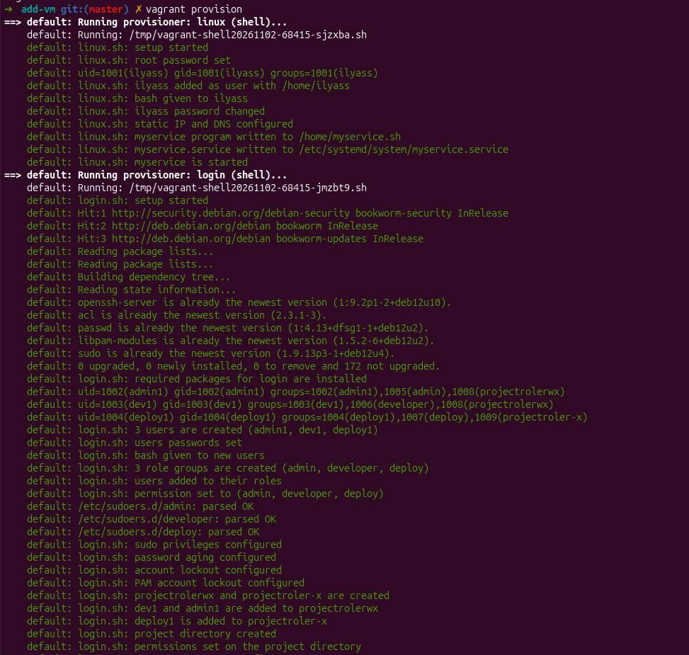
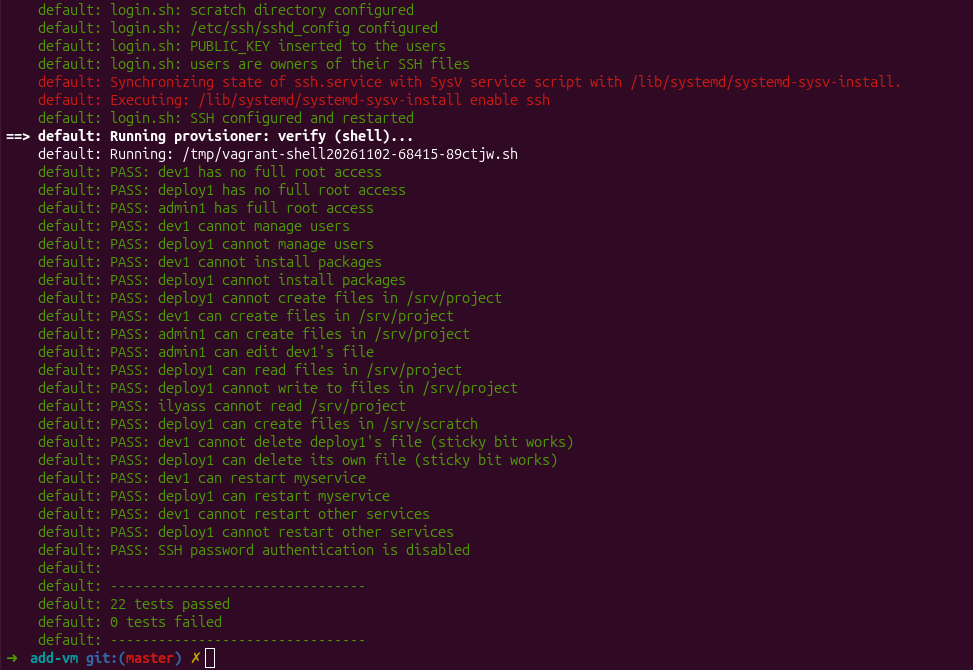
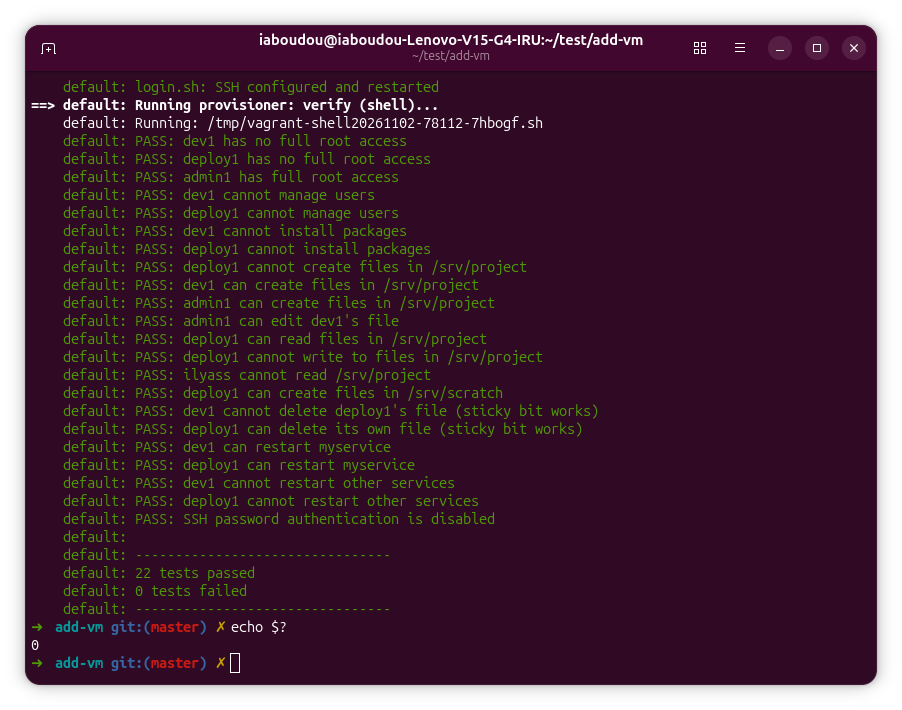

#### add-vm

the `linux` and `login` projects rebuilt by one command (`vagrant up`), with no prompt.

#### Approach

**Minimal base box + provisioning** (no preseed/cloud-init).
A stock minimal Debian box (`generic/debian12`) is configured entirely by the shell scripts in `provision/`.

Why this approach:
- It is faster to rebuild than building a custom image (Packer + preseed): `vagrant up` downloads the box once, then only the scripts run.
- All configuration stays in short, readable, idempotent shell scripts, so every setting is visible in git.
- The cost is that partitioning is fixed by the box (see Disk layout below).

#### Disk layout

The partitioning is fixed by the box. Result of `lsblk` on the built machine:

```
NAME   MAJ:MIN RM   SIZE RO TYPE MOUNTPOINTS
sda      8:0    0   128G  0 disk
├─sda1   8:1    0   487M  0 part /boot
├─sda2   8:2    0   1.9G  0 part [SWAP]
└─sda3   8:3    0 125.6G  0 part /
```

| Partition |    Size   |  Mount  | Decided by |
|-----------|-----------|---------|------------|
| `sda1`    | 487 MB    | `/boot` |   the box  |
| `sda2`    | 1.9 GB    |  swap   |   the box  |
| `sda3`    | 125.6 GB  |   `/`   |   the box  |

Comparison with the `linux` project (manual install):

|                       |       `linux` project             |       this repository             |
|-----------------------|-----------------------------------|-----------------------------------|
| Scheme                | LVM, volume group `vg`            |   plain partitions, no LVM        |
| `/`                   |       5 GB LV                     |   all remaining space (`sda3`)    |
| `/home`               |      2 GB separate LV             |       not separate (inside `/`)   |
| `/var`                |      2 GB separate LV             |       not separate (inside `/`)   |
| swap                  |           1 GB LV                 |           1.9 GB partition        |
| Free space in the VG  |       kept for `lvextend`         |               none (no VG)        |

What the box decides: the partition table, the filesystem of `/`, `/boot` and swap, and the disk size (128 GB, virtual, thin-provisioned).

What provisioning could still add: a second virtual disk with LVM volumes for `/home` and `/var` (idempotent, each step guarded by a check). Not implemented: the layout stays the box's default.

#### Repository structure

```
add-vm
├── README.md
|── screenshots
├── Vagrantfile
├── setup.sh             # prepares the host (SSH key, known_hosts, Vagrantfile check)
└── provision
    ├── linux.sh         # linux project configuration
    ├── login.sh         # login project configuration
    └── verify.sh        # verification script of the login project (regression test)
```

#### Requirements

- Vagrant (https://developer.hashicorp.com/vagrant/install#linux): `vagrant --version`
- VirtualBox (x86-64): `VBoxManage --version`
- Git

#### Build

```
    git clone https://github.com/iaboudou/sys-admin.git
    cd add-vm
    ./setup.sh
    vagrant up
```

Before the first build, `./setup.sh` generates the SSH key (`~/.ssh/vm_vagrant`) used by the Vagrantfile, removes the old host key from `known_hosts` and checks the Vagrantfile syntax. Then `vagrant up` builds and configures the machine.

Rebuild from scratch:

```
    vagrant destroy -f
    vagrant up
```

Re-run the provisioning on a running machine:

```
    vagrant provision
```

#### Vagrantfile

|           Setting         |       Value                                                                  |
|---------------------------|------------------------------------------------------------------------------|
| `config.vm.box`           | `generic/debian12`                                                           |
| `config.vm.box_version`   | `4.3.12`                                                                     |
| `config.vm.hostname`      | `hostilyass`                                                                 |
|       `vb.name`           | `hostilyass`                                                                 |
|       `vb.memory`         | `2048`                                                                       |
|       `vb.cpus`           | `2`                                                                          |
|       provisioners        | `provision/linux.sh`, then `provision/login.sh`, then `provision/verify.sh`  |

`verify.sh` runs as the last provisioner on every `vagrant up` / `vagrant provision`. If an assertion fails, the script exits with code 1 and Vagrant reports an error: this is intentional, the machine did not reach the expected state.

#### SSH key

`login.sh` needs an input given by the Vagrantfile:

- `PUBLIC_KEY` (environment variable): public SSH key installed for `admin1`, `dev1`, `deploy1`.

The Vagrantfile reads the key from `~/.ssh/vm_vagrant.pub`, which is created by `./setup.sh` if it does not exist. If this file is missing, `PUBLIC_KEY` is empty and nobody can log in over SSH as `admin1`, `dev1` or `deploy1` (`vagrant ssh` still works, so `verify.sh` still runs). So run `./setup.sh` before `vagrant up`.

Connect with:

```
    ssh -p 2222 -i ~/.ssh/vm_vagrant dev1@127.0.0.1
```

After a rebuild (`vagrant destroy -f` then `vagrant up`), if SSH reports `REMOTE HOST IDENTIFICATION HAS CHANGED`, remove the old host key from `known_hosts` (`./setup.sh` does it too):

```
    ssh-keygen -f ~/.ssh/known_hosts -R '[127.0.0.1]:2222'
```

#### provision/linux.sh

Both scripts start with `set -euo pipefail` (stop on any error) and `export DEBIAN_FRONTEND=noninteractive` (no debconf question).

1. Users and passwords:
   - `root:123`
   - user `ilyass` created only if missing (`id ilyass || useradd -m ilyass`), shell `/bin/bash`, password `ilyass`.
2. Static IPv4 and DNS:
   - `/etc/network/interfaces` is rewritten (`lo` + `eth0` static: `10.0.2.15/24`, gateway `10.0.2.2`).
   - `/etc/resolv.conf` is recreated with `nameserver 1.1.1.1`.
3. Service script: 
    - `/home/myservice.sh` (executable). Every 2 s it checks `/home/myservice_check.txt`, recreates it if missing, and logs `file recreated` / `file exists`.
4. systemd unit: 
    - `/etc/systemd/system/myservice.service` (`Type=simple`, `Restart=always`, `WantedBy=multi-user.target`).
5. Start: 
    - `systemctl daemon-reload`
    - `systemctl enable myservice.service`
    - `systemctl restart myservice.service`

Check:

```
    systemctl is-enabled myservice.service
    systemctl is-active myservice.service
    journalctl -u myservice.service -n 10
```

#### provision/login.sh

1. Packages: 
    - `apt-get update`, 
    - `apt-get install -y openssh-server acl passwd libpam-modules sudo`.
2. Users (created only if missing, shell `/bin/bash`): 
    - `admin1`, `dev1`, `deploy1`. Passwords: `admin1:admin1`, `dev1:dev1`, `deploy1:deploy1`, `vagrant:123`.
3. Role groups (created only if missing): 
    - `admin`, `developer`, `deploy`; each user is added to its role group.
4. sudo (`/etc/sudoers.d/`, mode `440`, checked with `visudo -cf`): 


   | File           | Rule                                                                                                                 |
   |----------------|----------------------------------------------------------------------------------------------------------------------|
   | `admin`        | `%admin ALL=(ALL:ALL) ALL`                                                                                           |
   | `developer`    | `%developer ALL=(root) NOPASSWD: /usr/bin/systemctl restart myservice, /usr/bin/systemctl restart myservice.service` |
   | `deploy`       | `%deploy ALL=(root) NOPASSWD: /usr/bin/systemctl restart myservice, /usr/bin/systemctl restart myservice.service`    |


5. Password aging: 
    - `chage -m 7 -M 90 -W 14 -I 30` on the 3 users.
6. Account lockout (PAM `pam_faillock`)
    - `/etc/security/faillock.conf`: `deny = 3`, `fail_interval = 900`, `unlock_time = 600`.
    - `/etc/pam.d/common-auth` and `/etc/pam.d/common-account` are rewritten with the faillock lines.
7. Shared directories
    - groups `projectrolerwx` (`admin1`, `dev1`) and `projectroler-x` (`deploy1`).
    - `/srv/project`: `chown root:projectrolerwx`, `chmod 2770`, ACL `g:projectroler-x:r-x`, default ACL `g:projectrolerwx:rwx` and `g:projectroler-x:r-x`.
    - `/srv/scratch`: `chmod 1777` (sticky bit).
8. SSH
    - `/etc/ssh/sshd_config` rewritten: `PubkeyAuthentication yes`, `PasswordAuthentication no`, `KbdInteractiveAuthentication no`, `PermitRootLogin prohibit-password`, `HostKey /etc/ssh/ssh_host_ed25519_key`.
    - `PUBLIC_KEY` written to `~/.ssh/authorized_keys` of each user (`700` on `.ssh`, `600` on the file, owned by the user).
9. Apply: 
    - `sshd -t`, `systemctl enable ssh`, `systemctl restart ssh`.

#### Idempotency

every step is safe to run several times:

- users and groups: created only if missing;
- config files (`sudoers.d`, `faillock.conf`, PAM, `sshd_config`, `authorized_keys`, `interfaces`, `resolv.conf`, unit file): overwritten with `>`, never appended, so nothing is duplicated;
- `mkdir -p`, `chmod`, `chown`, `setfacl`, `chage`, `usermod -aG`: same result on every run.

Test:

```
    vagrant provision
    vagrant provision
```

Both runs must end without error.




#### Verification (regression test)

`provision/verify.sh` is the verification script of the login project, unchanged. It is also the last provisioner of the Vagrantfile (named `verify`), and it runs as root on the VM. To run it alone on the running machine:

```
    vagrant provision --provision-with verify
    echo $?
```

Expected: only `PASS` lines, exit code `0`.

Proof after a rebuild:

```
    vagrant destroy -f
    vagrant up
    vagrant provision
    echo $?
```

Output:



#### Snapshots

```
    vagrant snapshot save clean      # take a snapshot
    # make a change, e.g. touch /home/proof.txt
    vagrant snapshot restore clean   # rollback
    vagrant snapshot list
    vagrant snapshot delete clean
```


- you can use a snapshot to experiment safely on a machine: test a risky change (PAM, sshd, sudoers) and come back to the exact previous state in seconds.
- Rebuild from code when the machine must match what the repository defines: after a change in the scripts, when the state is unknown or drifted, for a second machine or a colleague. a snapshot captures a moment (and ages with the box); the code captures the intent.

#### Architecture

|           | x86-64 (Intel / AMD)              | Apple Silicon (ARM64)                     |
|-----------|-----------------------------------|-------------------------------------------|
| Provider  | VirtualBox (used here)            | QEMU (`vagrant-qemu`) or VMware Fusion    |
| Box       | `generic/debian12` 4.3.12 (amd64) | an arm64 Debian 12 box                    |


Built on: x86-64, VirtualBox, `generic/debian12` 4.3.12.

On Apple Silicon only the provider, the provider block of the Vagrantfile and the box change. The scripts in `provision/` contain no architecture-specific package, URL or box name. The network interface name (`eth0`) and the box name are the only values to adapt.

#### Credentials (lab only)

| User      | Password      | Role          |
|-----------|---------------|---------------|
| root      | 123           |               |
| vagrant   | 123           |               |
| ilyass    | ilyass        |               |
| admin1    | admin1        | admin         |
| dev1      | dev1          | developer     |
| deploy1   | deploy1       | deploy        |

SSH password login is disabled: only key login works.
