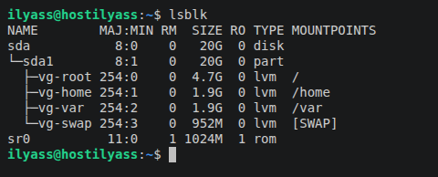
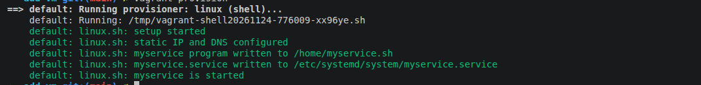
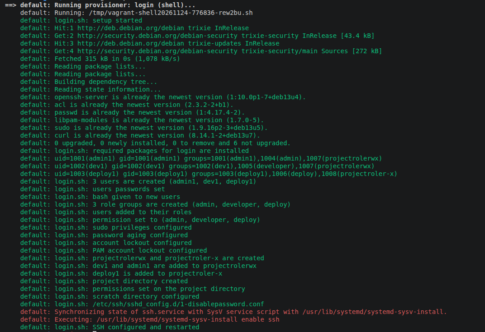

### add-vm

The goal of this `add-vm` is to reproduce the configurations from the `linux` and `login` automatically using Vagrant.
instead of manually installing and configuring the server, all the required steps are defined in code and executed automatically when running: `vagrant up`

### Approach

The `base box approach` is used; start from a ready-made Debian box and handle the rest through provisioning scripts.
The VM was packaged into a reusable Vagrant box using:

```bash
vagrant package --base "vm" --output debian.box
```

The generated debian.box file was then uploaded to GitHub, making it available for reuse in this project.
here Vagrant downloads it by itself (`config.vm.box_url`).
for the provisioning, When the machine starts, Vagrant runs two scripts with no questions:
   - `provision/linux.sh` sets up the network and the custom systemd service.
   - `provision/login.sh` sets up users, groups, sudo, permissions and SSH.
At the end, the `login` verification script runs to test the machine.
No one needs to type anything. The machine is ready and tested at the end.


Why this approach ?
- It is simple and fast: no need to install Debian again each time. The box already has Debian, so only the scripts run.
- No questions: one command, `vagrant up`, builds the full machine. Nobody has to type anything.
- The box is always the same, so the result is always the same.
- Anyone can clone the repository and run `vagrant up` to automatically create the same configured machine using the provided scripts.
- The box decides the disk partitions (they come from my `linux`). Provisioning does not change them. If needed, an extra disk could be added and mount with a script.

    

another box can be used like [generic/debian12](https://portal.cloud.hashicorp.com/vagrant/discover/generic/debian12).

### Repository structure

```
add-vm
├── README.md
|── screenshots
├── Vagrantfile
├── setup.sh             # installs Vagrant in the user folder (x86-64 Linux)
└── provision
    ├── linux.sh         # linux configuration
    ├── login.sh         # login configuration
```


### Architecture

Built on
- CPU: x86-64 (Intel / AMD)
- Provider: VirtualBox
- Base box: `debian-custom` (amd64), downloaded from GitHub

Other architectures
- **Intel Mac (x86-64):** same as above. VirtualBox works.
- **Apple Silicon Mac (ARM64):** VirtualBox does not work. Two things must change:
  - **Provider:** use QEMU (`vagrant-qemu` plugin) or VMware Fusion.
  - **Base box:** use an arm64 box, not an amd64 one.

The Vagrant commands stay the same (`vagrant up`, `vagrant destroy`). The scripts in `provision/` do not change, because they do not depend on the CPU.


### Snapshots

1. Procedure
```bash
# Take a snapshot
vagrant snapshot save clean-state

# Make a change
vagrant ssh -c "touch ~/test-file"

# Go back to a snapshot
vagrant snapshot restore clean-state

# Check that the change is gone
vagrant ssh -c "ls ~/test-file"
```

Other useful commands:
```bash
vagrant snapshot list
vagrant snapshot delete clean-state
```

2. When to use a snapshot ?
- To test something risky and go back fast (for example, a change in the SSH or sudo configuration).
- Before an experiment, when the machine is in a good state.
- A snapshot saves one moment of the machine. It is quick, but it is local to one computer.

3. When to rebuild from code ?
- When the machine is broken and the cause is not clear.
- When the machine has changed by hand and no longer matches the scripts.
- When a new person needs the same machine, or a second machine is needed.
- A rebuild uses the code (`vagrant destroy -f` then `vagrant up`), so the result is always the same and can be shared through git.

4. Short rule :
- A snapshot saves one moment. The code saves what the machine must always be.


### Rebuild

1. run the command
```bash
vagrant destroy -f
vagrant up
```

2. Result
- The machine was rebuilt with no manual input.
- `vagrant up` finished with no error.
- The `login` verification script ran at the end, unchanged, and every check passed.
- Rebuild time: about 2 to 6 min.






The scripts can run many times with the same result.
```bash
vagrant provision
```
It finishes with no error, and nothing is duplicated (no repeated users, no repeated lines in config files).

### Users

| User      | Role          |
|-----------|---------------|
| root      | -             |
| ilyass    | -             |
| admin1    | admin         |
| dev1      | developer     |
| deploy1   | deploy        |


### How to build
Requirements: Git, Vagrant, VirtualBox, and internet (the box and the verification script are downloaded).
```bash
git clone https://github.com/iaboudou/sys-admin.git
cd sys-admin/add-vm
vagrant up
```


### setup.sh
If Vagrant is not installed and there are no admin rights, run `./setup.sh`.
It installs Vagrant in `~/.local/bin`. It is only for x86-64 Linux.