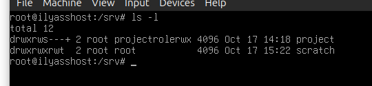

## Login 

### Table of Contents
        1. Overview 
        2. Prerequisites
        3. Access Control Model 
        4. Sudo Configuration   
        5. Password Policy  
            5.1 Password Aging (chage)  
            5.2 Account Lockout (PAM)   
        6. Shared Directories   
            6.1 Project Directory   
            6.2 Scratch Directory   
            6.3 Mechanism Table 
        7. SSH Hardening    
        8. Verification Script  
        9. Repository Structure 

### 1. Overview

This project creates an access control policy on a server that is shared by three roles: administrator, developer and deployer. This project aims to apply the principle of least privilege. This project ensures that each role can do the actions that its job needs and nothing more.

The policy covers:

- User and group management with one group for each role.
- Command-scoped sudo rules stored in `/etc/sudoers.d/`.
- Password aging (`chage`) and account lockout (PAM).
- A shared project directory protected with POSIX ACLs and special bits (`setgid` and sticky).
- Key-based SSH authentication with password login disabled.
- An automated verification script (`verify.sh`) that proves each restriction actually holds.

All roles interact with the systemd service `myservice.service` which was created in the `linux` project. This project verifies every claim in this document using `verify.sh` rather than assuming it is true.

### 2. Prerequisites

Before touching packages or sudoers, `apt update` needs to work.

Check `/etc/apt/sources.list`:

Then, as root:

    apt update
    apt install openssh-server acl passwd libpam-modules sudo

Here's what each one is for:

- `openssh-server` — the SSH server, needed for key-based authentication.
- `acl` — provides `setfacl` and `getfacl` for the shared directories.
- `passwd` — provides `chage`, used for password aging.
- `libpam-modules` — provides `pam_faillock`, used for account lockout.

On a minimal Debian install, some of these are already there. Listing them
anyway keeps the setup reproducible.

### 3. Access Control Model

Three roles are defined. Each role is modeled as a group, so privileges are
assigned once per role instead of per user.

| Role      | Group       | User     |
|-----------|-------------|----------|
| admin     | admin       | admin1   |
| developer | developer   | dev1     |
| deploy    | deploy      | deploy1  |

* `adduser user` adds a new user
* `addgroup role` adds a new role group
* `adduser user role` assigns the role to the user

for the Permissions every user must be able to have a role:
- admin : can manage users, install packages, restart any service
- developer: can read/write the shared directory, restart the service, he is not allowed to install packages or manage users
- deploy: can restart the service, read the shared directory, but doesn't have the permission to write to shared directory or to install packages 

### 4. Sudo Configuration

you do not edit `/etc/sudoers` , but rather put privileges in `/etc/sudoers.d/` . All files are checked for syntax with `visudo`.

| File                        | Content                                                                                                                          |
|-----------------------------|---------------------------------------------------------------------------------------------------------------------------------|
| `/etc/sudoers.d/admin`      | `%admin ALL=(ALL:ALL) ALL`                                                                                                                             |
| `/etc/sudoers.d/developer`  | `%developer ALL=(root) NOPASSWD: /usr/bin/systemctl restart myservice, /usr/bin/systemctl restart myservice.service` |
| `/etc/sudoers.d/deploy`     | `%deploy ALL=(root) NOPASSWD: /usr/bin/systemctl restart myservice, /usr/bin/systemctl restart myservice.service`   |

Created with:

    visudo -f /etc/sudoers.d/admin
    visudo -f /etc/sudoers.d/developer
    visudo -f /etc/sudoers.d/deploy

 for Least-privilege rules:

- Privileges are granted to groups, never directly to users.
- Only admin1 has full privileges, via `%admin ALL=(ALL:ALL) ALL`.
- Neither developer nor deploy is a member of the `sudo` group, which on Debian grants `ALL=(ALL:ALL) ALL` and would override any scoped rule.
- Command-scoped rules only: developer and deploy are limited to
  `/usr/bin/systemctl restart myservice` (and the `myservice.service` form, since sudo compares arguments exactly).

verify with :

    sudo -l -U admin1
    sudo -l -U dev1
    sudo -l -U deploy1

Only admin1 has full privileges. Any other role showing them is a policy failure.

### 5. Password Policy

#### 5.1. Password expiration (chage)

password aging is applied on a per-user basis with `chage`, which changes the relevant fields in `/etc/shadow`, this is the command used (for `admin1`, `dev1` and `deploy1`):

    sudo chage -m 7 -M 90 -W 14 -I 30 <username>

- `-m (7)`  : minimum days before the user may change the password
- `-M (90)` : maximum days a password stays valid
- `-W (14)` : days of warning shown before the password expires
- `-I (30)` : days after expiration before the account is disabled

the `/etc/shadow` (via `chage`) file we be changed but no manual edit should performed. you can verify with `sudo chage -l <username>`

#### 5.2. Account Lockout (PAM)  

After 3 failed logins, the account is locked for 10 minutes (`pam_faillock`).

**Files changed**

- `/etc/security/faillock.conf`: the lockout values
- `/etc/pam.d/common-auth`: counts failed logins
- `/etc/pam.d/common-account`: applies the lock

**a. add to `/etc/security/faillock.conf`**

    deny = 3
    fail_interval = 900
    unlock_time = 600

- `deny = 3`: lock after 3 failed attempts
- `fail_interval = 900`: the failures must happen within 15 minutes
- `unlock_time = 600`: unlock automatically after 10 minutes

**b. add to `/etc/pam.d/common-auth`**

    auth    required                    pam_faillock.so preauth
    auth    [success=1 default=ignore]  pam_unix.so nullok
    auth    [default=die]               pam_faillock.so authfail
    auth    sufficient                  pam_faillock.so authsucc
    auth    requisite                   pam_deny.so
    auth    required                    pam_permit.so

- `preauth` (before the password check): refuses the login if the account is already locked
- `authfail`: adds 1 to the failure counter after a wrong password
- `authsucc`: resets the counter after a correct password

**c. add to `/etc/pam.d/common-account`**

    account required                    pam_faillock.so

**Test**

As root, `su` never asks for a password, so no failure is counted. Run the attempts from a non-root user:

    su - usertest
    su - dev1                           # wrong password 3 times
    exit

Then as root:

    sudo faillock --user dev1           # shows the failures
    sudo faillock --user dev1 --reset   # unlock

Keep a root shell open while editing `/etc/pam.d/*`, in case of a mistake.

### 6. Shared Directories  

#### 6.1 Project Directory

`/srv/project` is shared by admin and developer (read/write). deploy can only read.

**Groups**

- `projectrolerwx`: admin1, dev1 (read/write)
- `projectroler-x`: deploy1 (read only)

Create them and the test user:

    addgroup projectrolerwx
    addgroup projectroler-x
    adduser admin1 projectrolerwx
    adduser dev1 projectrolerwx
    adduser deploy1 projectroler-x
    adduser usertest

**Setup**

    mkdir /srv/project
    chown root:projectrolerwx /srv/project
    chmod 2770 /srv/project
    setfacl -m    g:projectroler-x:r-x  /srv/project
    setfacl -d -m g:projectrolerwx:rwx  /srv/project
    setfacl -d -m g:projectroler-x:r-x  /srv/project

**Why**

- `chown`: root owns the directory, so only root can change its permissions.
- `chmod 2770`: setgid makes new files inherit the group `projectrolerwx`; others get no access.
- `setfacl -m`: lets deploy1 enter and read the directory.
- `setfacl -d` (default ACL): every new file is group-writable for `projectrolerwx` and read-only for `projectroler-x`, without any `chmod`.

Default ACLs only apply to files created after they are set.

**Check the ACL**

    getfacl /srv/project
    # default:group:projectrolerwx:rwx
    # default:group:projectroler-x:r-x

`default:` means the entry is inherited by every new file created in the directory. So a file created by dev1 is automatically `rw` for the group `projectrolerwx` (admin1 can edit it) and read-only for `projectroler-x`, without anyone running `chmod`.

**Test**

Switch to each user with `su - <user>`, run the command, then `exit`.

**dev1** (must work)

    su - dev1
    echo "hello" > /srv/project/b.txt     # create a file
    exit

**admin1** (must work)

    su - admin1
    echo "ok" >> /srv/project/b.txt       # edit dev1's file
    cat /srv/project/b.txt                # shows: hello / ok
    exit

**deploy1** (read yes, write no)

    su - deploy1
    cat /srv/project/b.txt                # works
    echo "x" >> /srv/project/b.txt        # Permission denied
    touch /srv/project/c.txt              # Permission denied
    exit

**usertest** (no access at all)

    su - usertest
    ls /srv/project                       # Permission denied
    exit

#### 6.2 Scratch Directory 

`/srv/scratch` is a shared area where everyone can write, but users can only delete their own files.

**Setup**

    mkdir -p /srv/scratch
    chmod 1777 /srv/scratch

**Why**

- `777`: any user can create and edit files here.
- `1` (sticky bit): a user can only delete or rename files they own. Root can delete anything.

**Check**

    ls -ld /srv/scratch      # drwxrwxrwt (the final "t" is the sticky bit)

**Test**

    su - dev1 -c 'touch /srv/scratch/a.txt'
    su - deploy1 -c 'rm /srv/scratch/a.txt'    # rm: cannot remove ... Operation not permitted

#### 6.3 Mechanism Table

Which permission mechanism is used where, and why.

| Goal | Mechanism | Where | Why |
|------|-----------|-------|-----|
| New files inherit the directory's group | setgid (`chmod 2770`) | `/srv/project` | Without it, new files belong to the creator's primary group. setgid forces `projectrolerwx`. |
| Group members can edit each other's files | Default ACL (`setfacl -d -m g:projectrolerwx:rwx`) | `/srv/project` | setgid fixes the group but not the write bit: with umask 022, new files are read-only for the group. The default ACL makes them group-writable without any `chmod`. |
| deploy can read new files but not write | Default ACL (`setfacl -d -m g:projectroler-x:r-x`) | `/srv/project` | deploy1 is not in `projectrolerwx`, so it needs its own entry. It gets read access without joining the writer group. |
| deploy can enter and list the directory | Access ACL (`setfacl -m g:projectroler-x:r-x`) | `/srv/project` | Without `x` on the directory, deploy1 cannot enter it, and the default ACLs on the files inside would be unreachable. |
| Others have no access | Mode `770` and `other::---` | `/srv/project` | Anyone outside the two groups is denied. |
| Only root can change the directory's permissions | Ownership (`chown root:projectrolerwx`) | `/srv/project` | Only the owner (root) can run `chmod` or `setfacl`. Group members can use the directory but not change its policy. |
| Users cannot delete other users' files | Sticky bit (`chmod 1777`) | `/srv/scratch` | The directory must stay world-writable for uploads, but the sticky bit allows only the file owner (or root) to delete a file. |
| Everyone can upload | `rwx` for others (`chmod 1777`) | `/srv/scratch` | The scratch area is intentionally open to all roles. The project directory is protected by its own ACLs. |

### 7. SSH Hardening

Every user logs in with an SSH key. Password login is disabled.

**1. Generate one key pair per user (on the client machine)**

    ssh-keygen -t ed25519 -f ~/.ssh/vm_il_dev_admin1
    ssh-keygen -t ed25519 -f ~/.ssh/vm_il_dev_dev1
    ssh-keygen -t ed25519 -f ~/.ssh/vm_il_dev_deploy1

**2. Install each public key on the server (as root, for each user)**

Example for dev1:

    mkdir -p /home/dev1/.ssh
    nano /home/dev1/.ssh/authorized_keys     # paste the content of vm_il_dev_dev1.pub
    chmod 700 /home/dev1/.ssh
    chmod 600 /home/dev1/.ssh/authorized_keys
    chown -R dev1:dev1 /home/dev1/.ssh

Same for `admin1` and `deploy1` with their own public key.
The VM uses NAT, so a VirtualBox port forward is set: host `127.0.0.1:2224` → guest `22`.

**3. Test key login before disabling passwords**

    ssh -p 2224 -i ~/.ssh/vm_il_dev_dev1 dev1@localhost

It must open a shell without asking for the account password.

**4. Disable password authentication in `/etc/ssh/sshd_config` on the server machine**

    PubkeyAuthentication yes
    PasswordAuthentication no
    KbdInteractiveAuthentication no
    PermitRootLogin prohibit-password

- `PubkeyAuthentication yes`: allow key login
- `PasswordAuthentication no`: refuse password login
- `KbdInteractiveAuthentication no`: closes the other password-style path
- `PermitRootLogin prohibit-password`: root can only log in with a key

**5. Check and restart**

    sshd -t
    systemctl restart ssh

**6. Proof**

Password login is refused:

    ssh -p 2224 -o PubkeyAuthentication=no -o PreferredAuthentications=password dev1@localhost
    # dev1@localhost: Permission denied (publickey).

Key login succeeds:

    ssh -p 2224 -i ~/.ssh/vm_il_dev_dev1 dev1@localhost 
    # opens the shell of dev1, no password

Effective server configuration (as root on the VM):

    sshd -T | grep -iE 'passwordauthentication|kbdinteractiveauthentication|pubkeyauthentication'
    # pubkeyauthentication yes
    # passwordauthentication no
    # kbdinteractiveauthentication no

### 8. Verification Script

`verify.sh` tests the policy: for each restricted role, it tries the forbidden actions and checks that each one is denied. It runs on the server, as root (it uses `sudo -u <user>` and `sudo -l -U <user>`).

    sudo ./verify.sh
    echo $?

- One `PASS` or `FAIL` line per assertion.
- Exit code `0` if every assertion passes, `1` if at least one fails.

| Role | Action tested | Expected |
|------|---------------|----------|
| dev1 / deploy1 | full root access (`sudo -l -U`) | denied |
| admin1 | full root access (`sudo -l -U`) | allowed |
| dev1 / deploy1 | manage users (`adduser`, `useradd`, `usermod`, `passwd`) | denied |
| dev1 / deploy1 | install packages (`sudo -n -l /usr/bin/apt`) | denied |
| dev1 / admin1 | create a file in `/srv/project` | allowed |
| deploy1 | create a file in `/srv/project` | denied |
| admin1 | edit dev1's file in `/srv/project` (no `chmod`) | allowed |
| deploy1 | read a file in `/srv/project` | allowed |
| deploy1 | write to a file in `/srv/project` | denied |
| ilyass (no group, no ACL) | read `/srv/project` | denied |
| deploy1 | create a file in `/srv/scratch` | allowed |
| dev1 | delete deploy1's file in `/srv/scratch` (sticky bit) | denied |
| deploy1 | delete its own file in `/srv/scratch` | allowed |
| dev1 / deploy1 | `sudo systemctl restart myservice` | allowed |
| dev1 / deploy1 | `sudo systemctl restart ssh` | denied |
| sshd | `sshd -T`: `passwordauthentication no` | password login disabled |

The SSH connection tests (password refused, key accepted) are done by hand from the host, see section 7.

**Detection test (break a rule on purpose)**

    visudo -f /etc/sudoers.d/developer
    # add: %developer ALL=(root) NOPASSWD: ALL

    sudo ./verify.sh; echo $?       # FAIL lines, exit code 1

Then remove the added line with `visudo -f /etc/sudoers.d/developer` and run the script again: all `PASS`, exit code `0`.
### 9. Repository Structure

    login/
    ├── README.md        # access model, password policy, permissions rationale
    ├── sudoers.d/       # copies of the /etc/sudoers.d/ policy files
    │   ├── admin        # admin role: full privileges
    │   ├── developer    # developer role: restart the service only
    │   └── deploy       # deploy role: restart the service only
    └── verify.sh        # verification script proving the policy holds

**Files**

- `README.md`: the access model, the password policy, and why each permission mechanism is used (sudo, ACL, setgid, sticky bit).
- `sudoers.d/`: copies of the live files in `/etc/sudoers.d/`, so the policy is versioned and can be reviewed without reading the server. The repo files are named after the roles; on the server they are installed as `admin`, `developer` and `deploy`.
- `verify.sh`: tries the forbidden actions of each role and prints one PASS or FAIL line per test. It exits with a non-zero code if any test fails.

In the `add-vm` project, `verify.sh` is reused as the regression test to check that a rebuilt machine still meets this policy.