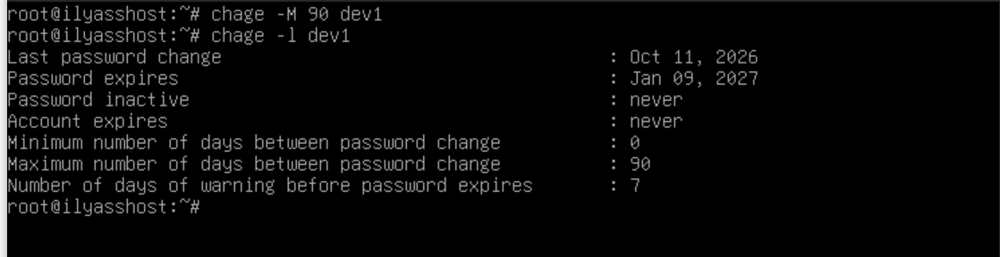
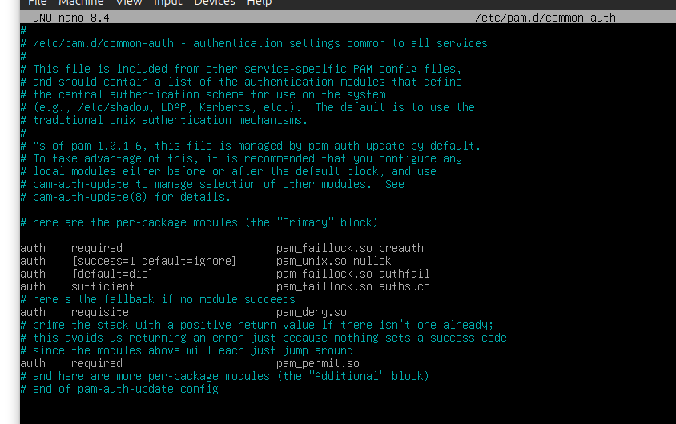
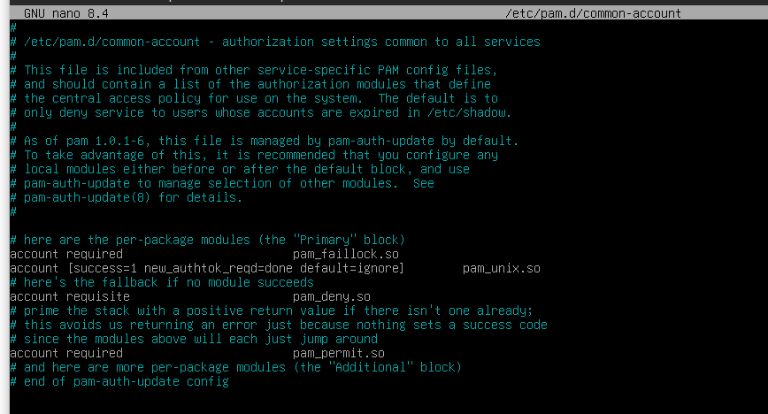
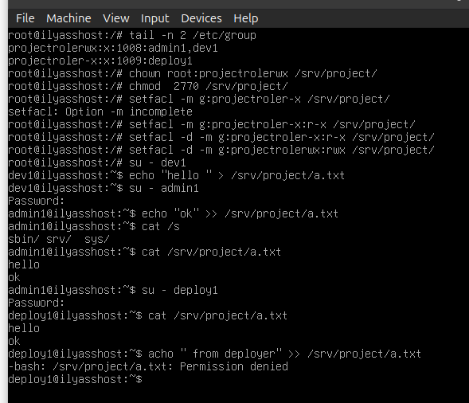

## Login 

### Table of Contents
        1. Overview 
        2. Prerequisites
        3. Access Control Model 
        4. Sudo Configuration   
        5. Password Policy  
            5.1 Password Aging (chage)  
            5.2 Account Lockout (PAM)   
        6. Shared Directories   
            6.1 Project Directory   
            6.2 Scratch Directory   
            6.3 Mechanism Table 
        7. SSH Hardening    
        8. Verification Script  
        9. Repository Structure 
        10. Security Principles & Conclusion  

### 1. Overview

This project creates an access control policy on a server that is shared by three roles: administrator, developer and deployer. This project aims to apply the principle of least privilege. This project ensures that each role can do the actions that its job needs and nothing more.

The policy covers:

- User and group management with one group for each role.
- Command-scoped sudo rules stored in `/etc/sudoers.d/`.
- Password aging (`chage`) and account lockout (PAM).
- A shared project directory protected with POSIX ACLs and special bits (`setgid` and sticky).
- Key-based SSH authentication with password login disabled.
- An automated verification script (`verify.sh`) that proves each restriction actually holds.
All roles interact with the systemd service `myservice.service` which was created in the `linux` project. This project verifies every claim in this document using `verify.sh` rather than assuming it is true.

### 2. Prerequisites

Before touching packages or sudoers, `apt update` needs to work.

Check `/etc/apt/sources.list`:

Then, as root:

    apt update
    apt install openssh-server acl passwd libpam-modules sudo

Here's what each one is for:

- `openssh-server` — the SSH server, needed for key-based authentication.
- `acl` — provides `setfacl` and `getfacl` for the shared directories.
- `passwd` — provides `chage`, used for password aging.
- `libpam-modules` — provides `pam_faillock`, used for account lockout.

On a minimal Debian install, some of these are already there. Listing them
anyway keeps the setup reproducible.

### 3. Access Control Model

Three roles are defined. Each role is modeled as a group, so privileges are
assigned once per role instead of per user.

| Role      | Group       | User     |
|-----------|-------------|----------|
| admin     | adminrole   | admin1   |
| developer | devrole     | dev1     |
| deploy    | deployrole  | deploy1  |

* `adduser user` adds a new user
* `addgroup role` adds a new role group
* `adduser user role` assigns the role to the user

for the Permissions every user must be able to have a role:
- admin : can manage users, install packages, restart any service
- developer: can read/write the shared directory, restart the service, he is not allowed to install packages or manage users
- deploy: can restart the service, read the shared directory, but doesn't have the permission to write to shared directory or to install packages 

### 4. Sudo Configuration

you do not edit `/etc/sudoers` , but rather put privileges in `/etc/sudoers.d/` . All files are checked for syntax with `visudo`.

| File                        | Content                                                       |
|-----------------------------|---------------------------------------------------------------|
| `/etc/sudoers.d/adminrole`  | `%adminrole ALL=(ALL:ALL) ALL`                                |
| `/etc/sudoers.d/devrole`    | `%devrole ALL=(root) NOPASSWD: /bin/systemctl start myservice`  |
| `/etc/sudoers.d/deployrole` | `%deployrole ALL=(root) NOPASSWD: /bin/systemctl start myservice` |

Created with:

    visudo -f /etc/sudoers.d/adminrole
    visudo -f /etc/sudoers.d/devrole
    visudo -f /etc/sudoers.d/deployrole

 for Least-privilege rules:

- Privileges are granted to groups, never directly to users.
- Only admin1 has full privileges, via `%adminrole ALL=(ALL:ALL) ALL`.
- Neither developer nor deploy is a member of the `sudo` group, which on
  Debian grants `ALL=(ALL:ALL) ALL` and would override any scoped rule.
- Command-scoped rules only: developer and deploy are limited to
  `/bin/systemctl start myservice`.

verify with :

    sudo -l -U admin1
    sudo -l -U dev1
    sudo -l -U deploy1

Only admin1 has full privileges. Any other role showing them is a policy failure.

### 5. Password Policy

#### 5.1. Password expiration (chage)

password aging is applied on a per-user basis with `chage`, which changes the relevant fields in `/etc/shadow`, this is the command used:

    sudo chage -m 7 -M 90 -W 14 -I 30 <username>

- `-m (7)`  : minimum days before the user may change the password
- `-M (90)` : maximum days a password stays valid
- `-W (14)` : days of warning shown before the password expires
- `-I (30)` : days after expiration before the account is disabled

the `/etc/shadow` (via `chage`) file we be changed but no manual edit should performed. you can verify with `sudo chage -l <username>`

#### 5.2. Account Lockout (PAM)  

After 3 failed logins, the account is locked for 10 minutes (`pam_faillock`).

**Files changed**

- `/etc/security/faillock.conf`: the lockout values
- `/etc/pam.d/common-auth`: counts failed logins
- `/etc/pam.d/common-account`: applies the lock

**a. add to `/etc/security/faillock.conf`**

    deny = 3
    fail_interval = 900
    unlock_time = 600

- `deny = 3`: lock after 3 failed attempts
- `fail_interval = 900`: the failures must happen within 15 minutes
- `unlock_time = 600`: unlock automatically after 10 minutes

**b. add to `/etc/pam.d/common-auth`**

    auth    required                    pam_faillock.so preauth
    auth    [success=1 default=ignore]  pam_unix.so nullok
    auth    [default=die]               pam_faillock.so authfail
    auth    sufficient                  pam_faillock.so authsucc
    auth    requisite                   pam_deny.so
    auth    required                    pam_permit.so

- `preauth` (before the password check): refuses the login if the account is already locked
- `authfail`: adds 1 to the failure counter after a wrong password
- `authsucc`: resets the counter after a correct password

**c. add to `/etc/pam.d/common-account`**

    account required                    pam_faillock.so

**Test**

    su - dev1                           # wrong password 3 times
    sudo faillock --user dev1           # shows the failures
    sudo faillock --user dev1 --reset   # unlock

Keep a root shell open while editing `/etc/pam.d/*`, in case of a mistake.

### 6. Shared Directories  

#### 6.1 Project Directory

`/srv/project` is shared by admin and developer (read/write). deploy can only read.

**Groups**

- `projectrolerwx`: admin1, dev1 (read/write)
- `projectroler-x`: deploy1 (read only)

**Setup**

    mkdir /srv/project
    chown root:projectrolerwx /srv/project
    chmod 2770 /srv/project
    setfacl -m    g:projectroler-x:r-x  /srv/project
    setfacl -d -m g:projectrolerwx:rwx  /srv/project
    setfacl -d -m g:projectroler-x:r-x  /srv/project

**Why**

- `chown`: root owns the directory, so only root can change its permissions.
- `chmod 2770`: setgid makes new files inherit the group `projectrolerwx`; others get no access.
- `setfacl -m`: lets deploy1 enter and read the directory.
- `setfacl -d` (default ACL): every new file is group-writable for `projectrolerwx` and read-only for `projectroler-x`, without any `chmod`.

Default ACLs only apply to files created after they are set.

**Test**

Switch to each user with `su - <user>`, run the command, then `exit`.

**dev1** (must work)

    su - dev1
    echo "hello" > /srv/project/b.txt     # create a file
    exit

**admin1** (must work)

    su - admin1
    echo "ok" >> /srv/project/b.txt       # edit dev1's file
    cat /srv/project/b.txt                # shows: hello / ok
    exit

**deploy1** (read yes, write no)

    su - deploy1
    cat /srv/project/b.txt                # works
    echo "x" >> /srv/project/b.txt        # Permission denied
    touch /srv/project/c.txt              # Permission denied
    exit

**usertest** (no access at all)

    su - usertest
    ls /srv/project                       # Permission denied
    exit

