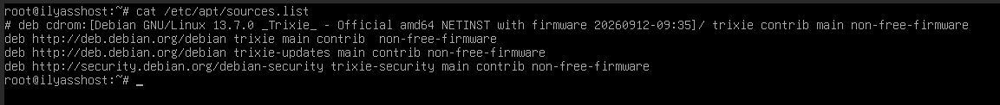
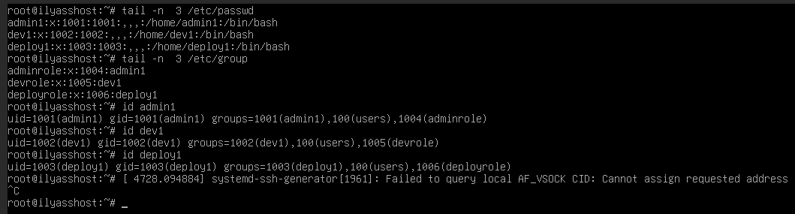
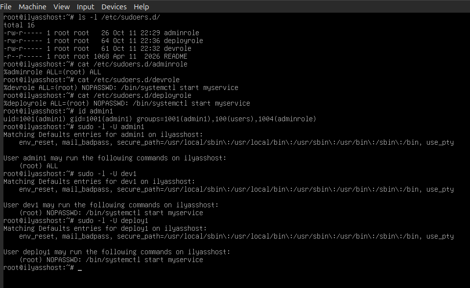

## Login 

### Table of Contents
        1. Overview 
        2. Prerequisites
        3. Access Control Model 
        4. Sudo Configuration   
        5. Password Policy  
            5.1 Password Aging (chage)  
            5.2 Account Lockout (PAM)   
        6. Shared Directories   
            6.1 Project Directory   
            6.2 Scratch Directory   
            6.3 Mechanism Table 
        7. SSH Hardening    
        8. Verification Script  
        9. Repository Structure 
        10. Security Principles & Conclusion  

### 1. Overview

This project creates an access control policy on a server that is shared by three roles: administrator, developer and deployer. This project aims to apply the principle of least privilege. This project ensures that each role can do the actions that its job needs and nothing more.

The policy covers:

- User and group management with one group for each role.
- Command-scoped sudo rules stored in `/etc/sudoers.d/`.
- Password aging (`chage`) and account lockout (PAM).
- A shared project directory protected with POSIX ACLs and special bits (`setgid` and sticky).
- Key-based SSH authentication with password login disabled.
- An automated verification script (`verify.sh`) that proves each restriction actually holds.
All roles interact with the systemd service `myservice.service` which was created in the `linux` project. This project verifies every claim in this document using `verify.sh` rather than assuming it is true.

### 2. Prerequisites

Before touching packages or sudoers, `apt update` needs to work.

Check `/etc/apt/sources.list`:

Then, as root:

    apt update
    apt install openssh-server acl passwd libpam-modules

Here's what each one is for:

- `openssh-server` — the SSH server, needed for key-based authentication.
- `acl` — provides `setfacl` and `getfacl` for the shared directories.
- `passwd` — provides `chage`, used for password aging.
- `libpam-modules` — provides `pam_faillock`, used for account lockout.

On a minimal Debian install, some of these are already there. Listing them
anyway keeps the setup reproducible.

### 3. Access Control Model

Three roles are defined. Each role is modeled as a group, so privileges are
assigned once per role instead of per user.

| Role      | Group       | User     |
|-----------|-------------|----------|
| admin     | adminrole   | admin1   |
| developer | devrole     | dev1     |
| deploy    | deployrole  | deploy1  |

* `adduser user` adds a new user
* `addgroup role` adds a new role group
* `adduser user role` assigns the role to the user

for the Permissions every user must be able to have a role:
- admin : can manage users, install packages, restart any service
- developer: can read/write the shared directory, restart the service, he is not allowed to install packages or manage users
- deploy: can restart the service, read the shared directory, but doesn't have the permission to write to shared directory or to install packages 

### 4. Sudo Configuration

you do not edit `/etc/sudoers` , but rather put privileges in `/etc/sudoers.d/` . All files are checked for syntax with `visudo`.

| File                        | Content                                                       |
|-----------------------------|---------------------------------------------------------------|
| `/etc/sudoers.d/adminrole`  | `%adminrole ALL=(ALL:ALL) ALL`                                |
| `/etc/sudoers.d/devrole`    | `%devrole ALL=(root) NOPASSWD: /bin/systemctl start myservice`  |
| `/etc/sudoers.d/deployrole` | `%deployrole ALL=(root) NOPASSWD: /bin/systemctl start myservice` |

Created with:

    visudo -f /etc/sudoers.d/adminrole
    visudo -f /etc/sudoers.d/devrole
    visudo -f /etc/sudoers.d/deployrole

Least-privilege rules:

- Privileges are granted to groups, never directly to users.
- Only admin1 has full privileges, via `%adminrole ALL=(ALL:ALL) ALL`.
- Neither developer nor deploy is a member of the `sudo` group, which on
  Debian grants `ALL=(ALL:ALL) ALL` and would override any scoped rule.
- Command-scoped rules only: developer and deploy are limited to
  `/bin/systemctl start myservice`.

verify with :

    sudo -l -U admin1
    sudo -l -U dev1
    sudo -l -U deploy1

Only admin1 has full privileges. Any other role showing them is a policy failure.

### 5. Password Policy 